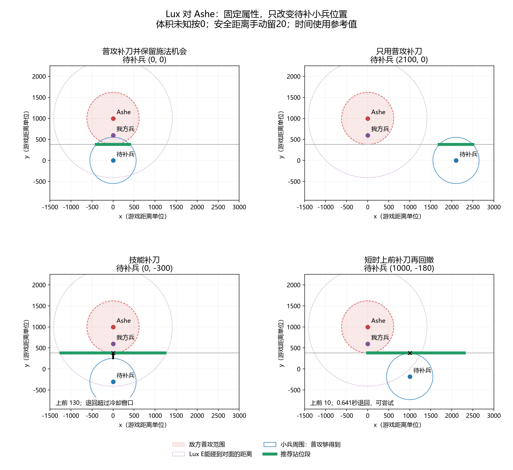

# 固定英雄属性、改变坐标的四种结果测试

查询及测试日期：2026-10-09。己方 Lux，敌方 Ashe，使用一级基础属性，不计装备、符文、增益及普攻重置。设 Lux 当前可用技能只有 E，因此最大施法范围为1100；不把其他已解锁或可用技能忽略后仍称作全技能最大范围。坐标是构造的模拟案例，不是游戏录像测量结果。原点仍为兵线交汇中心；敌方不站在原点。

## 数据与输入口径

| 参数 | 数值 | 来源与口径 |
|---|---:|---|
| Ashe 普攻距离 | 600 | [Riot Codex / Ashe](https://riotcodex.net/champions/Ashe)，页面标注26.19 |
| Ashe 移速、攻速 | 325、0.658 | 同上，一级基础属性 |
| Lux 普攻距离、移速 | 550、330 | [Riot Codex / Lux](https://riotcodex.net/champions/Lux)，页面标注26.20 |
| Lux E 圆心施法距离、范围半径 | 1100、310 | 同上 |
| 己方最大施法范围 | 1100 | 本例仅E可用，取圆心最远施法距离，不叠加作用半径 |
| 用于消耗的中心命中距离 | 1410 | 1100+310，目标体积为0时的圆形技能几何上限；不是圆心施法距离 |
| 英雄、小兵半径 | 全部0 | 未核实的数据按用户要求填0；不代表真实单位没有体积 |
| 额外安全距离 | 20 | 手动选择的演示值；脚本默认仍为0 |
| 玩家反应时间、普攻前摇 | 0.28秒、0.30秒 | 脚本参考默认值，不是 Lux 的实测时间 |
| Ashe 前摇 | 0.303951秒 | 默认攻击周期的20%除以0.658，估计值，不是已核实的英雄前摇 |

Riot Codex 是非官方资料站；两个页面返回的版本标注不同。因此这里只报告本次实际查到的数值，不宣称整套输入都是同一版本的官方完整数据。LoL Wiki 本次未能直接读取，未用无法核实的半径补齐数据。

交互选择“游戏显示的普攻距离”，三个体积全部回车按0。己方最大施法范围1100，消耗技能距离1410；普攻补刀不可行时，交互入口自动沿用1410计算技能补刀候选，不再重复询问。独立后台案例使用圆形技能距离1100、半径310，得到相同的1410有效距离。敌方最大施法范围与具体技能均暂不考虑；仅验证普攻安全。1410表示可把E圆心放在1100以内，使310半径覆盖目标中心；它不是最大施法范围。

## 四个坐标案例

共同坐标：敌方英雄 E=(0,1000)，正在被敌方普攻的我方小兵 F=(0,600)。两者相距400，满足 Ashe 可以普攻该兵。只改变待补的敌方小兵 T，其他参数全部固定。

| 案例 | 待补兵 T | 推荐结果 | 普攻站位段 / 技能站位段 |
|---|---|---|---|
| 1 | (0,0) | 普攻补刀并保留施法机会；具体E距离也够 | 普攻：x∈[-397.618,397.618]，y=380 |
| 2 | (2100,0) | 普攻补刀，先不强求消耗 | 普攻：x∈[1702.382,2497.618]，y=380 |
| 3 | (0,-300) | 改用技能补刀 | 技能：x∈[-1235.192,1235.192]，y=380 |
| 4 | (1000,-180) | 可尝试短时上前普攻，再回撤 | 技能也可用：x∈[0,2294.025]，y=380；窗口从(1000,380)出发 |

这里的“能补刀”指距离或出手机会成立；没有输入小兵血量、伤害和弹道，所以不保证最后一击成功。第二例是为了覆盖“不强求消耗”的分支，横向距离较大；不代表常见兵线布局。所有站位段都限制在当前切线上，不代表整个平面的全部解。

第四类与技能补刀可以同时成立。脚本应提供备选行动，而不是强行把四类划为互斥结果。

## 为什么窗口一例失败、一例成功

从 Ashe 普攻弹道出手时开始计时，剩余普攻冷却估计为：

`(1-0.20)/0.658 = 1.215805 秒`。

| 窗口参数 | 案例3：技能补刀 | 案例4：短时普攻 |
|---|---:|---:|
| 等机会的位置 | (0,380) | (1000,380) |
| 进入普攻范围的位置 | (0,250) | (1000,370) |
| 需要上前的距离 | 130 | 10 |
| A出这一刀 | 0.973939秒 | 0.610303秒 |
| 按计划退回所需时间 | 1.367879秒 | 0.640606秒 |
| 窗口是否成立 | 否，尚未退回 | 是 |

案例4在敌方普攻转好时，追击模拟给出的双方距离约971.288，超过包含安全裕量的620约351.288。该距离还包含退回等待点后继续远离敌方的移动，不能理解为停在等待点的距离。

窗口采用敌方立刻追击、己方普攻已转好、小兵短时不移动的模型。真实体积和前摇改动后，分类可能改变；例如补上体积可能让第四例直接拥有普攻站位，便不再需要短时进场。默认0和参考时间便于输入，但不能代替实战校准。

## 验证与复现

在项目目录运行：

```powershell
python examples/four_outcomes.py
python -m unittest -q
```

四个案例分别检查后台区间、模拟窗口以及完整交互输入流程。还逐例检查整体平移、90度旋转、距离与移速同步缩小为0.01倍：相对几何不变时，结果和窗口时间保持一致。33项回归测试全部通过，包含后台各距离的独立性、交互自动沿用消耗距离补刀、敌方圆形技能距离起点、回退站位逐点显示己方最大施法范围，以及固定方向未覆盖不等于已完成躲避的检查。

本次发现交互入口还是旧流程，已更新为当前后台对应的默认值、技能类型输入、普攻补刀优先和短时窗口分支。算法判定由核心模块负责。

完整输入与输出见 [four_outcomes_transcript.txt](four_outcomes_transcript.txt)，可执行案例见 [four_outcomes.py](four_outcomes.py)。


