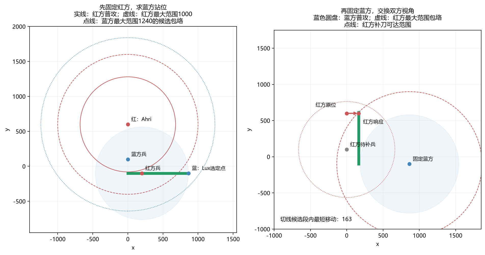
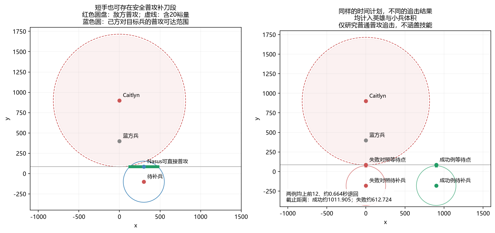

# 补刀站位原则：数学基础与局部行动窗口

*Last-Hit Positioning Principle*

## 摘要

补刀站位原则研究一个局部问题：已知敌方英雄、敌方准备攻击的己方小兵，以及己方准备补刀的敌方小兵的位置，如何寻找既能补刀、又避开敌方普攻的候选站位？进一步地，哪些位置仍保留对敌方施法的距离条件？如果静态站位不能普攻目标，是否存在短时进场、出手、回撤的行动窗口？

本文先把单位体积纳入中心距离，再沿敌方普攻安全边界的切线建立正交坐标。这样，二维距离条件可以转化为一个参数的区间，多个要求则对应区间交集。随后分别讨论最大施法范围、具体技能的命中范围，以及敌方追击时的回撤判据。最后通过两组有来源的英雄参数展示双向站位响应，以及长短手对线中的补刀可能性。

切线是便于快速求解的候选构造，不是整个平面可行站位的全集。本文证明的是给定假设下的几何和时间可行性，不直接证明伤害、命中概率或补刀收益最优。

## 1. 单位命名、研究对象与坐标

### 1.1 官方名称与本文符号

英文术语采用《英雄联盟》官方用法。官方[英雄列表](https://www.leagueoflegends.com/en-us/champions/)使用 **Champion**，复数为 **Champions**。[25.S1.1版本说明](https://www.leagueoflegends.com/en-us/news/game-updates/patch-25-s1-1-notes/)使用 **Melee Minion**，[26.6版本说明](https://www.leagueoflegends.com/en-us/news/game-updates/league-of-legends-patch-26-6-notes/)使用 **Caster Minion**；**Siege Minion** 和 **Super Minion** 可见于[11.20版本说明](https://www.leagueoflegends.com/en-us/news/game-updates/patch-11-20-notes/)。

| 对象 | 英文名称 | 本文符号 |
|---|---|---|
| 英雄 | Champion | $C$ |
| 未指定兵种的小兵 | Minion | $M$ |
| 近战兵 | Melee Minion | $MM$ |
| 远程兵 | Caster Minion | $CM$ |
| 攻城兵／炮车兵 | Siege Minion | $SiM$ |
| 超级兵 | Super Minion | $SuM$ |

英文名称来自官方资料，**上述数学缩写是本文约定**。尤其是 $SiM$ 和 $SuM$，用于避免两类单位都写成 $SM$。位置符号用斜体，英文说明性下标用正体，例如 $C_{\mathrm{self}}$、$MM_{\mathrm{enemy}}$。符号表示单位的中心坐标，不表示其半径或射程。

下标 $\mathrm{self}$ 表示当前分析一方，$\mathrm{enemy}$ 表示对方；交换分析视角时，这两个身份随之交换。数值例中用 $\mathrm{blue}$、$\mathrm{red}$ 固定表示阵营，避免交换视角后混淆同一单位。若有多个同类单位，可再加序号，例如 $CM_{\mathrm{enemy},1}$。

### 1.2 三个已知位置与一个待求位置

基本构造使用三个已知中心：

- $C_{\mathrm{enemy}}$：敌方英雄。
- $M_{\mathrm{self}}$：敌方即将普攻的己方小兵。
- $M_{\mathrm{enemy}}$：己方准备补刀的敌方小兵。

待求位置是己方英雄中心 $C_{\mathrm{self}}$。兵种已知时，将通用的 $M$ 换成 $MM$、$CM$ 等即可，公式不因此改变。

为什么需要两只兵？敌方英雄与其补刀目标确定局部朝向；己方补刀目标决定沿这个朝向构造的候选线中，哪些位置能攻击到小兵。三点可以共线，不必形成非退化三角形，但必须有

$$
C_{\mathrm{enemy}}\ne M_{\mathrm{self}},
$$

否则敌方到小兵的方向无法定义。敌方确实能攻击 $M_{\mathrm{self}}$ 是场景前提，需要先根据其普攻距离与单位半径核验。

原点 $O=(0,0)$ 取兵线交汇中心，坐标轴采用固定的两条正交地图方向。通常场景中敌方不在交汇中心；这属于场景设定，不是公式要求。后面的计算只用位置差，因此不依赖原点的绝对位置。

静态分析暂时固定三个已知中心；动态分析只在短窗口内固定小兵位置。这里研究关键残血小兵，不将整条兵线的移动、伤害和仇恨全部纳入模型。

## 2. 把游戏距离转换成可计算的中心距离

### 2.1 普攻距离为什么需要单位半径

几何公式计算中心之间的距离。若某次普通攻击按两个玩法圆的边缘距离判定，则资料中的普攻距离还不能直接作为中心距离。

设普攻距离为 $A_{\mathrm{enemy}},A_{\mathrm{self}}$，英雄玩法半径为 $r_{\mathrm{enemy}},r_{\mathrm{self}}$，目标兵玩法半径为 $r_{M,\mathrm{enemy}}$。敌方能攻击己方英雄的中心距离上限为

$$
d_{\mathrm{threat}}
=A_{\mathrm{enemy}}+r_{\mathrm{enemy}}+r_{\mathrm{self}}.
$$

己方能普攻目标兵的中心距离上限为

$$
d_{\mathrm{last}}
=A_{\mathrm{self}}+r_{\mathrm{self}}+r_{M,\mathrm{enemy}}.
$$

这两个量分别回答“对方能否打到我”和“我能否打到目标兵”，通常不同。原因不仅是双方普攻距离可能不同，还包括英雄与小兵半径不同。对应判定为

$$
\|C_{\mathrm{self}}-C_{\mathrm{enemy}}\|\le d_{\mathrm{threat}},
\qquad
\|C_{\mathrm{self}}-M_{\mathrm{enemy}}\|\le d_{\mathrm{last}}.
$$

符号 $\|P-Q\|$ 表示两个中心的欧氏距离。

若已有参数本身就是中心有效距离，直接使用它，不能再次加半径。特殊攻击也应按实际机制确定可达范围。玩法半径与模型显示大小、点击选取半径、寻路半径是不同参数；后两者不能直接代替攻击判定半径。

### 2.2 最大施法范围只是一项距离参考条件

设己方当前可用技能集合为 $\mathcal K_{\mathrm{self}}$，技能 $k$ 的施法距离为 $L_{\mathrm{self},k}$。这里“可用”要求已经学习、满足资源条件且不在冷却中。将各技能统一到所采用的中心参考口径后，对非空的可用技能集合，定义
$$
R_{\mathrm{self}}=\sup_{k\in\mathcal K_{\mathrm{self}}}L_{\mathrm{self},k},
\qquad
R_{\mathrm{enemy}}=\sup_{k\in\mathcal K_{\mathrm{enemy}}}L_{\mathrm{enemy},k}.
$$
有限技能集合中，这就是最大的施法距离；全图技能可用时可取 $+\infty$。若没有可用技能，本文约定该参考范围为0，并另外标明无可用技能。

所有可用技能都参加比较，包括护盾、治疗等非伤害技能。因此
$$
\|C_{\mathrm{self}}-C_{\mathrm{enemy}}\|\le R_{\mathrm{self}}
$$
表示“敌方位于己方最大施法范围参考包络内”，不能单独推出“有技能能消耗敌方”。例如最大距离来自只能对友方释放的护盾，该技能并不能因此攻击敌方。

对圆形技能，施法距离通常描述圆心最远能放在哪里，作用半径描述圆有多大；最大施法范围中不能自动把二者相加。反过来，超出某方最大施法范围也不一定避开其范围技能外缘。

### 2.3 具体消耗技能与补刀技能另行计算

记具体消耗技能对敌方英雄的中心命中距离为 $D_{\mathrm{harass}}$，具体补刀技能对目标小兵的中心命中距离为 $D_{\mathrm{spell}}$。它们可以来自同一个技能，也可以来自不同技能，不必等于最大施法范围。

例如圆心最远施法距离为 $L$、作用半径为 $h$ 的圆形技能，在可自由选落点、目标静止且无阻挡的模型中，对半径 $r$ 的目标有
$$
D=L+h+r.
$$
推导很直接：把圆心放到最远距离 $L$，技能区域再向外延伸 $h$，目标玩法圆再提供 $r$ 的相交距离。这个公式说明“施法圆心距离”和“能覆盖目标中心的距离”为什么不同。

技能是否允许该目标、会不会被阻挡、弹道和目标是否同时到达，仍需额外条件。本文的距离公式不能代替这些机制；作用半径也不能重复加入已经换算好的有效距离。

## 3. 先定义安全与补刀要求，再选择候选线

设额外安全裕量为 $\delta\ge0$，将构造半径定义为
$$
\rho=d_{\mathrm{threat}}+\delta.
$$
裕量是研究者选定的距离参数，不是英雄的固定属性。若采用缩放后的坐标，它必须与所有其他长度同比缩放。

同时考虑普攻补刀、避开敌方普攻及最大施法范围参考条件，可写出全平面集合
$$
\mathcal G=
\left\{C_{\mathrm{self}}:
\begin{array}{l}
\|C_{\mathrm{self}}-C_{\mathrm{enemy}}\|\ge\rho,\\
\|C_{\mathrm{self}}-M_{\mathrm{enemy}}\|\le d_{\mathrm{last}},\\
\|C_{\mathrm{self}}-C_{\mathrm{enemy}}\|\le R_{\mathrm{self}}
\end{array}
\right\}.
$$
第一行要求离危险源足够远；第二行要求离目标兵足够近；第三行保留施法距离参考条件。它们分别是圆盘外部、圆盘内部、另一个圆盘内部，交集可能有许多位置。

当 $\delta=0$ 时，闭边界上的点仍可能被敌方普攻：严格不可攻击要求距离大于 $d_{\mathrm{threat}}$。使用闭边界便于计算，但必须保留这项区别。

直接研究整个二维集合可以更全面，快速选择却需要额外规则。本文选择朝向敌方补刀目标的安全边界切线，把站位问题降为一维。代价是可能舍弃平面中的其他解；“切线上无解”不能解释成“任何地方都无法补刀”。

## 4. 切线如何把二维距离拆成两个分量

### 4.1 确定朝向与切点

先定义敌方朝向其补刀目标的单位向量
$$
u=\frac{M_{\mathrm{self}}-C_{\mathrm{enemy}}}
{\|M_{\mathrm{self}}-C_{\mathrm{enemy}}\|},
\qquad n=(-u_y,u_x).
$$
$u$ 是正面方向，$n$ 是与它垂直的横向方向。两者长度都为1，且 $u\cdot n=0$。

从敌方中心沿 $u$ 走 $\rho$，得到安全圆边界点
$$
Q=C_{\mathrm{enemy}}+\rho u.
$$
通过 $Q$、沿 $n$ 的直线就是该圆的切线。线上候选位置为
$$
C_{\mathrm{self}}(s)=Q+sn,\qquad s\in\mathbb R.
$$
$s$ 是从 $Q$ 沿切线移动的有符号距离；负值表示沿相反方向。

候选点到敌方的向量为 $\rho u+sn$。利用正交性展开平方：
$$
\begin{aligned}
\|C_{\mathrm{self}}(s)-C_{\mathrm{enemy}}\|^2
&=(\rho u+sn)\cdot(\rho u+sn)\\
&=\rho^2\|u\|^2+2\rho s(u\cdot n)+s^2\|n\|^2\\
&=\rho^2+s^2.
\end{aligned}
$$
因此整条线都在构造圆外或边界上。这里是精确等式，不是近似。若 $\delta>0$，所有候选点都严格超出敌方普攻距离；若 $\delta=0$，只有 $s=0$ 贴在普攻可达边界上。

### 4.2 找出目标兵的垂直距离与横向位置

把目标兵相对于 $Q$ 的向量投影到两个方向：
$$
d_{\mathrm{normal}}=(M_{\mathrm{enemy}}-Q)\cdot u,
\qquad
s_{\mathrm{minion}}=(M_{\mathrm{enemy}}-Q)\cdot n.
$$
其中 $|d_{\mathrm{normal}}|$ 是目标兵到切线的垂直距离，$s_{\mathrm{minion}}$ 是目标兵在切线上的垂足位置参数。投影可能为负，所以公式中保留符号。

由于 $u,n$ 构成正交单位基，
$$
M_{\mathrm{enemy}}-Q=d_{\mathrm{normal}}u+s_{\mathrm{minion}}n.
$$
从候选点减去目标兵，得到
$$
C_{\mathrm{self}}(s)-M_{\mathrm{enemy}}
=-d_{\mathrm{normal}}u+(s-s_{\mathrm{minion}})n.
$$
再次应用勾股关系：
$$
\boxed{\|C_{\mathrm{self}}(s)-M_{\mathrm{enemy}}\|^2
=d_{\mathrm{normal}}^2+(s-s_{\mathrm{minion}})^2.}
$$
接下来的区间公式都来自这个等式：垂直距离固定，只有横向位置 $s$ 可以选择。

## 5. 从距离不等式得到站位区间

### 5.1 普攻目标兵的区间

普攻补刀要求
$$
d_{\mathrm{normal}}^2+(s-s_{\mathrm{minion}})^2\le d_{\mathrm{last}}^2.
$$
若 $|d_{\mathrm{normal}}|>d_{\mathrm{last}}$，即使站在垂足上也够不到目标，因此 $I_{\mathrm{attack}}=\varnothing$。

否则先移项，再开平方：
$$
(s-s_{\mathrm{minion}})^2\le d_{\mathrm{last}}^2-d_{\mathrm{normal}}^2,
$$
$$
|s-s_{\mathrm{minion}}|
\le\sqrt{d_{\mathrm{last}}^2-d_{\mathrm{normal}}^2}.
$$

所以

$$
\boxed{I_{\mathrm{attack}}=
\left[s_{\mathrm{minion}}-\sqrt{d_{\mathrm{last}}^2-d_{\mathrm{normal}}^2},
s_{\mathrm{minion}}+\sqrt{d_{\mathrm{last}}^2-d_{\mathrm{normal}}^2}\right].}
$$

区间以垂足参数为中心，两端是普攻圆与切线的交点。垂直距离越大，剩余横向空间越小；相等时只剩一个点。

### 5.2 最大施法范围参考区间

敌我距离平方已经是 $\rho^2+s^2$，因此参考条件为

$$
\rho^2+s^2\le R_{\mathrm{self}}^2.
$$

有限 $R_{\mathrm{self}}<\rho$ 时，整条切线都太远，故 $I_{\mathrm{cast}}=\varnothing$；否则

$$
I_{\mathrm{cast}}=
\left[-\sqrt{R_{\mathrm{self}}^2-\rho^2},
\sqrt{R_{\mathrm{self}}^2-\rho^2}\right].
$$

全图技能对应 $I_{\mathrm{cast}}=\mathbb R$。这个区间只回答参考距离是否满足，不能代表具体消耗技能命中。

### 5.3 为什么还可以限制到目标兵一侧

目标兵的垂足位于 $s_{\mathrm{minion}}$。为了优先考虑同侧候选，可定义

$$
I_{\mathrm{side}}=
\begin{cases}
[0,+\infty),&s_{\mathrm{minion}}>0,\\
(-\infty,0],&s_{\mathrm{minion}}<0,\\
\mathbb R,&s_{\mathrm{minion}}=0.
\end{cases}
$$

这是减少候选的策略选择，不是安全所必需的条件；需要研究另一侧时可以取消。

同时满足三项要求的区间为

$$
\boxed{I_{\mathrm{base}}
=I_{\mathrm{attack}}\cap I_{\mathrm{cast}}\cap I_{\mathrm{side}}.}
$$

若各区间为 $[\ell_i,h_i]$，取

$$
\ell=\max_i\ell_i,\qquad h=\min_i h_i.
$$

当 $\ell\le h$ 时，交集为 $[\ell,h]$；当 $\ell>h$ 时，没有共同候选。空集可能只是施法参考条件太严，而不是普攻补刀本身不可能。

## 6. 分清无解的原因，逐项放宽要求

若还要求具体消耗技能能覆盖敌方，应另求

$$
I_{\mathrm{harass}}=\{s:\rho^2+s^2\le D_{\mathrm{harass}}^2\},
$$

再与 $I_{\mathrm{base}}$ 相交。它与施法参考区间的求解形式相同，但物理含义不同，不能互相代替。

当 $I_{\mathrm{base}}$ 为空时，先取消最大施法范围参考条件：

$$
I_{\mathrm{last}}=I_{\mathrm{attack}}\cap I_{\mathrm{side}}.
$$

若这个集合非空，仍然存在切线上避开敌方普攻、同时能普攻目标兵的位置，只是不能同时保证处于己方最大施法范围参考包络内。

若 $I_{\mathrm{last}}$ 仍为空，再考虑具体补刀技能。把第5.1节的 $d_{\mathrm{last}}$ 换成 $D_{\mathrm{spell}}$，得到

$$
J_{\mathrm{spell}}=
\begin{cases}
\varnothing,&|d_{\mathrm{normal}}|>D_{\mathrm{spell}},\\
\left[s_{\mathrm{minion}}-\sqrt{D_{\mathrm{spell}}^2-d_{\mathrm{normal}}^2},
s_{\mathrm{minion}}+\sqrt{D_{\mathrm{spell}}^2-d_{\mathrm{normal}}^2}\right],
&|d_{\mathrm{normal}}|\le D_{\mathrm{spell}}.
\end{cases}
$$

技能候选区间为

$$
I_{\mathrm{spell}}=J_{\mathrm{spell}}\cap I_{\mathrm{side}}.
$$

这里沿用的安全只针对敌方普攻；具体技能风险还要单独检查。若还要保留最大施法范围或消耗条件，再分别与 $I_{\mathrm{cast}}$、$I_{\mathrm{harass}}$ 相交。

这种放宽顺序表达“先保留普攻补刀，再考虑技能补刀”的取舍。普攻、技能和短时进场方案可以同时存在，不是互斥的三类结果。

## 7. 从一段候选位置中选择代表点

对非空有限区间 $I=[\ell,h]$，并不存在未经定义就成立的“最佳站位”。可以先确定一个简单目标：

1. **离目标兵最近。** 因为目标距离平方只有 $(s-s_{\mathrm{minion}})^2$ 随 $s$ 变化，取

   $$
   s_{\mathrm{near}}=\operatorname{clamp}(s_{\mathrm{minion}},\ell,h).
   $$

   $\operatorname{clamp}$ 表示：若垂足在区间内就取垂足，否则取较近端点。

2. **取区间中间位置。** 取 $s_{\mathrm{mid}}=(\ell+h)/2$。这只是几何中点，不是收益均衡的证明。

3. **尽量远离敌方。** 因为敌我距离随 $|s|$ 增加而增大，取绝对值较大的端点：

   $$
   s_{\mathrm{far}}\in\arg\max_{s\in\{\ell,h\}}|s|.
   $$

选定参数后，用 $C_{\mathrm{self}}=Q+sn$ 还原地图坐标。若已知己方当前位置 $P_{\mathrm{current}}$，还可以最小化到该位置的移动距离。其无约束投影参数为 $(P_{\mathrm{current}}-Q)\cdot n$，再截取到区间内即可。

这些规则各自优化一个明确量。单位碰撞、地形、仇恨、技能与伤害可能使几何极值不可用，不能仅凭“最近”或“最远”就宣称总体最优。

## 8. 技能形状判定与躲避时间是两个问题

第2节的中心命中距离研究自由瞄准的可达性。若要判断敌方朝某个方向释放后是否覆盖站位，需要使用技能的实际形状。

### 8.1 圆形技能

假设敌方以 $Q$ 为技能圆心，圆心施法距离为 $L_{\mathrm{enemy}}$，作用半径为 $h_{\mathrm{enemy}}$。必须同时满足

$$
\|Q-C_{\mathrm{enemy}}\|\le L_{\mathrm{enemy}},
\qquad
\|C_{\mathrm{self}}-Q\|\le h_{\mathrm{enemy}}+r_{\mathrm{self}}.
$$

第一项保证圆心放得出来，第二项保证技能圆与己方玩法圆相交。不能省略第一项，也不能把半径无条件加到最大施法范围中。

### 8.2 直线技能

假设技能从敌方中心沿 $u$ 发射，纵向长度 $L_{\mathrm{enemy}}$，完整宽度 $w_{\mathrm{enemy}}$，简化为有限矩形。将己方位置写到技能坐标中：

$$
p=(C_{\mathrm{self}}-C_{\mathrm{enemy}})\cdot u,
\qquad
q=(C_{\mathrm{self}}-C_{\mathrm{enemy}})\cdot n.
$$

矩形在纵向覆盖 $[0,L_{\mathrm{enemy}}]$，横向覆盖
$[-w_{\mathrm{enemy}}/2,w_{\mathrm{enemy}}/2]$。

点到这两个区间的距离分别为

$$
e_{\mathrm{long}}=\max(-p,0,p-L_{\mathrm{enemy}}),
\qquad
e_{\mathrm{lat}}=\max(|q|-w_{\mathrm{enemy}}/2,0).
$$

若点在某个区间内，对应距离为0；越过矩形端点或侧边，距离就是超出的部分。点到矩形的最短距离由勾股关系给出，因此玩法圆与矩形相交当且仅当

$$
e_{\mathrm{long}}^2+e_{\mathrm{lat}}^2\le r_{\mathrm{self}}^2.
$$

技能宽度扩大横向区域，不能直接加到纵向距离上。若实际弹道不是矩形，应使用真实形状。

### 8.3 不被当前方向覆盖，不等于已经躲开技能

固定朝兵线或固定瞄准 $Q$ 只是一个释放假设。某点不在这个区域内，说明该次假定释放没有覆盖它；敌方改变方向或落点后可能命中。

若该点正在区域内，但己方可能在弹道到达前走出去，必须进一步知道技能前摇、弹道速度、释放时刻、目标移动及反应时间。静态图形判定没有这些变量，不能默认“移动来得及”，也不能据此宣称“已经避开”。普攻回撤窗口同样不能代替技能躲避计算。

## 9. 静态普攻不够时：短时进场、出手与回撤

### 9.1 从固定等待点进入普攻范围

先在目标侧选择离目标兵最近的切线等待点：

$$
s_{\mathrm{wait}}=\operatorname{proj}_{I_{\mathrm{side}}}(s_{\mathrm{minion}}),
\qquad P_{\mathrm{wait}}=Q+s_{\mathrm{wait}}n.
$$

这里 $\operatorname{proj}$ 表示投影到允许区间；等待点不必满足最大施法范围条件。

记 $d_{\mathrm{target}}=\|M_{\mathrm{enemy}}-P_{\mathrm{wait}}\|$。若目标兵在普攻距离之外，最短进入距离是

$$
d_{\mathrm{move}}=\max(0,d_{\mathrm{target}}-d_{\mathrm{last}}).
$$

当 $d_{\mathrm{move}}>0$ 时，沿目标方向走到普攻圆边缘：

$$
P_{\mathrm{attack}}=P_{\mathrm{wait}}
+\frac{d_{\mathrm{move}}}{d_{\mathrm{target}}}
(M_{\mathrm{enemy}}-P_{\mathrm{wait}}).
$$

当 $d_{\mathrm{move}}=0$ 时取 $P_{\mathrm{attack}}=P_{\mathrm{wait}}$，无需除以可能为0的距离。

直线是从固定等待点到目标普攻圆盘的最短路径，但可能穿入敌方普攻范围；因此它的可行性需要下面的时间窗口，而不能套用切线上的静态安全结论。

### 9.2 先检查时间够不够

设己方移速为 $v_{\mathrm{self}}>0$，反应延迟为 $\tau_{\mathrm{reaction}}$，普攻前摇为 $\tau_{\mathrm{self}}$。假设普攻已转好，反应后进入、停下完成前摇、立即原路返回，则

$$
t_{\mathrm{attack}}=\tau_{\mathrm{reaction}}
+\frac{d_{\mathrm{move}}}{v_{\mathrm{self}}}+\tau_{\mathrm{self}},
$$

$$
t_{\mathrm{return}}=\tau_{\mathrm{reaction}}
+\frac{2d_{\mathrm{move}}}{v_{\mathrm{self}}}+\tau_{\mathrm{self}}.
$$

前一个时刻是攻击出手，后一个是回到等待点。弹道命中与小兵死亡可能更晚，不由出手时刻直接确定。

时间原点取敌方上一发普通攻击已经出手的时刻。敌方攻速为 $\alpha_{\mathrm{enemy}}$，完整攻击周期为 $1/\alpha_{\mathrm{enemy}}$，上一发前摇为 $\tau_{\mathrm{enemy}}$。在通常的攻击周期模型下，下一次攻击可开始的剩余时间为

$$
t_{\mathrm{ready}}=\frac{1}{\alpha_{\mathrm{enemy}}}-\tau_{\mathrm{enemy}}.
$$

减去前摇，是因为时间原点已经位于上一发攻击的出手时刻，而不是其前摇开始时刻。攻击重置、攻速改变或特殊计时机制出现时，应改用实际剩余时间。

要求在敌方下一次普攻可开始前完成此计划，至少需要

$$
t_{\mathrm{return}}\le t_{\mathrm{ready}}.
$$

它也蕴含 $t_{\mathrm{attack}}\le t_{\mathrm{ready}}$。移项可得到直观的进入距离上限：

$$
\boxed{d_{\mathrm{move}}\le
\frac{v_{\mathrm{self}}}{2}
(t_{\mathrm{ready}}-\tau_{\mathrm{reaction}}-\tau_{\mathrm{self}}).}
$$

若括号为负，这个计划连反应与前摇都容不下；若非负，它只说明时间够用，还没说明敌方追上来后是否安全。

### 9.3 再检查敌方追击后的距离

设敌方出手后立即以速度 $v_{\mathrm{enemy}}$ 追击。己方在反应与前摇阶段停留，按上述路线进入、返回，然后持续远离敌方。相应轨迹记为

$$
C_{\mathrm{enemy}}(0)=C_{\mathrm{enemy}},
\qquad C_{\mathrm{self}}(0)=P_{\mathrm{wait}}.
$$

纯追击模型中，敌方始终朝己方当前位置移动：

$$
\dot C_{\mathrm{enemy}}(t)=
v_{\mathrm{enemy}}
\frac{C_{\mathrm{self}}(t)-C_{\mathrm{enemy}}(t)}
{\|C_{\mathrm{self}}(t)-C_{\mathrm{enemy}}(t)\|}.
$$

分子给出追击方向，分母把方向归一化，乘移速后得到速度。返回等待点之后，己方采用相反意义的径向远离：

$$
\dot C_{\mathrm{self}}(t)=
v_{\mathrm{self}}
\frac{C_{\mathrm{self}}(t)-C_{\mathrm{enemy}}(t)}
{\|C_{\mathrm{self}}(t)-C_{\mathrm{enemy}}(t)\|}.
$$

双方重合时分母为0，需要单独处理，不能继续使用这个方向公式。

记敌我距离为 $d(t)$，截止距离与剩余裕量为

$$
d_{\mathrm{end}}=d(t_{\mathrm{ready}})
=\|C_{\mathrm{self}}(t_{\mathrm{ready}})
-C_{\mathrm{enemy}}(t_{\mathrm{ready}})\|,
\qquad
\Delta_{\mathrm{safe}}=d_{\mathrm{end}}-\rho.
$$

在本计划及“敌方此前不能再次普攻”的假设下，要求出手和回撤已经完成，并有 $\Delta_{\mathrm{safe}}>0$。这保证截止时刻仍在带裕量的普攻边界外；不保证之后无限时间安全。若己方更慢，敌方继续追击仍可能追上。

还可以先给出无需积分的保守下界。初始距离为 $d_{\mathrm{initial}}$，敌方返回前最多移动 $v_{\mathrm{enemy}}t_{\mathrm{return}}$，而己方已经回到原等待点，因此

$$
d(t_{\mathrm{return}})
\ge d_{\mathrm{initial}}-v_{\mathrm{enemy}}t_{\mathrm{return}}.
$$

返回后双方径向运动，距离变化率为 $v_{\mathrm{self}}-v_{\mathrm{enemy}}$，故在轨迹不重合时

$$
d_{\mathrm{end}}\ge
d_{\mathrm{initial}}-v_{\mathrm{enemy}}t_{\mathrm{return}}
+(v_{\mathrm{self}}-v_{\mathrm{enemy}})
(t_{\mathrm{ready}}-t_{\mathrm{return}}).
$$

下界已经大于 $\rho$ 时，可以直接证明该窗口中的距离条件；下界不足并不等于实际轨迹失败，此时可进一步求解追击轨迹。数值结果接近安全边界时，需要保留足以覆盖积分误差的余量。

## 10. 为什么用切线，以及圆弧能解决什么

切线的优点是安全条件自动满足，其他圆形距离条件都变成一元区间。它没有证明运动轨迹最优。

若希望沿安全圆边界寻找候选，可改用

$$
C_{\mathrm{self}}(\theta)=C_{\mathrm{enemy}}
+\rho(\cos\theta,\sin\theta).
$$

圆弧可以提供切线舍弃的位置。可是“最优路线一定是圆弧”仍需要先指定优化目标、起终点、地形与时间约束；在不同问题中，最短路线可能是直线、圆弧或二者组合。

切线与圆周的局部差异可以精确解释。使用第4节的基，对 $|s|\le\rho$，同一横向参数与切点所在半圆对应的圆周点为

$$
C_{\mathrm{arc}}(s)=C_{\mathrm{enemy}}
+\sqrt{\rho^2-s^2}\,u+sn.
$$

切线点的法向系数为 $\rho$，圆周点的系数为 $\sqrt{\rho^2-s^2}$，两者相差

$$
e_{\mathrm{normal}}
=\rho-\sqrt{\rho^2-s^2}
=\frac{s^2}{\rho+\sqrt{\rho^2-s^2}}.
$$

当 $|s|\ll\rho$ 时，分母接近 $2\rho$，所以差量约为 $s^2/(2\rho)$。这说明切线在切点附近近似圆周，但远处差异增大。应区分两件事：切线近似圆周形状是局部近似，切线站位到敌方的距离公式始终精确。

## 11. 原点、方向与量纲为什么不改变判定

平移坐标原点不会改变位置差；整体旋转不会改变距离与内积。因此同时平移或旋转所有单位和候选线后，区间可行性与对应站位保持一致。镜像可能翻转参数符号，但不会凭空产生或消除可行位置。

若统一把全部长度乘以 $\lambda>0$，则坐标、普攻有效距离、施法距离、半径、宽度、裕量和区间端点都乘以 $\lambda$。例如

$$
d_{\mathrm{normal}}'^2+(s'-s_{\mathrm{minion}}')^2
\le d_{\mathrm{last}}'^2
$$

两边同时乘了 $\lambda^2$，所以真假不变。原数据中的“500”与同比缩放后的“5”可以描述相同几何关系。

动态分析还必须把移速同比缩放：

$$
v_{\mathrm{self}}'=\lambda v_{\mathrm{self}},
\qquad
\frac{d_{\mathrm{move}}'}{v_{\mathrm{self}}'}
=\frac{d_{\mathrm{move}}}{v_{\mathrm{self}}}.
$$

反应时间、前摇、攻击周期与攻速不随长度缩放。只改距离不改移速，会改变窗口结论。尺度一致也不能消除参数估计误差：估计值仍应作为带不确定性的场景参数。

## 12. 数值例一：Lux与Ahri——等普攻距离下的双向站位响应

### 12.1 查询数据与情境

蓝色方为Lux，红色方为Ahri。查询日期为2026-10-09；以下普攻及技能距离采用当日Riot Codex页面列值，两页均标记26.20。玩法半径采用LoL Wiki可查询资料快照。坐标是为展示推导构造的局部情境，不是某一场录像的实测坐标，也不将资料快照视为逐帧实测。

设双方三级，Q、W、E均已学习且当前可用，R尚未解锁；不计装备、符文及体积变化。

| 参数 | 蓝方Lux | 红方Ahri |
|---|---:|---:|
| 普攻距离，边缘口径 | 550 | 550 |
| 英雄玩法半径 | 65 | 65 |
| Q距离 | 1240 | 900 |
| W距离 | 1175 | 725 |
| E圆心／纵向施法距离 | 1100 | 1000 |
| 当前最大施法范围 | $R_{\mathrm{blue}}=1240$ | $R_{\mathrm{red}}=1000$ |

距离来源：[Lux](https://riotcodex.net/champions/Lux)、[Ahri](https://riotcodex.net/champions/Ahri)。英雄半径来源：[LoL Wiki单位半径表](https://leagueoflegends.fandom.com/wiki/Unit_radius)。两只关键小兵均取近战兵，玩法半径48，参照[LoL Wiki体积表](https://leagueoflegends.fandom.com/wiki/Size)。这些参数都能独立查询；不同资料的版本与判定口径仍需区分。

最大施法范围从所有当前可用技能中取最大值，包含W；本例最大值恰好由伤害技能取得。它不等于具体消耗技能的有效命中距离。上述范围用于本文的标量距离参考条件，不计Ahri位移或连续施法产生的复合接近距离。

取额外安全裕量 $\delta=20$，这是示例条件，不是游戏固定数据。记红方英雄初始位置、蓝方关键小兵、红方关键小兵分别为：

$$
C_{\mathrm{red}}^{(0)}=(0,600),\qquad MM_{\mathrm{blue}}=(0,100),\qquad MM_{\mathrm{red}}=(200,-100).
$$

所有坐标仍以兵线交汇中心为原点。红方到蓝方关键兵的中心距离为500，低于普攻该兵的有效距离 $550+65+48=663$，因此红方即将普攻该兵的情境成立。

双方普攻英雄的中心有效距离均为：

$$
d_{\mathrm{hero}}=550+65+65=680.
$$

双方普攻小兵的中心有效距离均为663。尽管资料普攻距离相同，英雄与小兵体积不同，因此这两种有效距离不能混用。

### 12.2 给定红方位置，先求蓝方候选

从蓝方视角取：

$$
C_{\mathrm{enemy}}=C_{\mathrm{red}}^{(0)},\qquad M_{\mathrm{self}}=MM_{\mathrm{blue}},\qquad M_{\mathrm{enemy}}=MM_{\mathrm{red}},\qquad
\rho=680+20=700.
$$

于是：

$$
u=(0,-1),\quad n=(1,0),\quad Q_{\mathrm{blue}}=(0,-100),
\quad C_{\mathrm{blue}}(s)=(s,-100).
$$

目标兵就在切线上，且垂足在切点正方向200处，因此正交坐标为 $d_{\mathrm{normal}}=0,s_{\mathrm{minion}}=200$，得到：

$$
I_{\mathrm{attack}}=[200-663,200+663]=[-463,863],
$$

$$
I_{\mathrm{cast}}=
[-\sqrt{1240^2-700^2},\sqrt{1240^2-700^2}]
\approx[-1023.523,1023.523],
\qquad I_{\mathrm{side}}=[0,+\infty).
$$

普攻区间先与施法参考区间相交，仍为[-463,863]；再限制到目标兵所在的正侧，留下[0,863]。所以蓝方候选区间为：

$$
\boxed{I_{\mathrm{blue},\mathrm{base}}=[0,863],\qquad C_{\mathrm{blue}}(s)=(s,-100).}
$$

按第7节的三个选择规则：

| 选择规则 | 蓝方位置 | 含义 |
|---|---|---|
| 离目标兵最近 | $(200,-100)$ | 到目标兵中心距离为0；具体单位碰撞另行约束 |
| 区间中点 | $(431.5,-100)$ | 取候选段中部 |
| 沿候选段最远离红方 | $(863,-100)$ | 最大化与当前红方位置的距离 |

第一项是点中心模型下的几何极值，英雄与小兵中心重合通常不符合单位碰撞，因此实际选择应另加碰撞约束；本文不把它当作可以照搬的精确像素站位。

为了完成下一步双向响应，明确选定：

$$
C_{\mathrm{blue}}^{(1)}=(863,-100).
$$

它距离目标兵663，恰好处于己方普攻小兵的可达边缘；距离红方英雄为：

$$
\|C_{\mathrm{blue}}^{(1)}-C_{\mathrm{red}}^{(0)}\|=\sqrt{863^2+700^2}\approx1111.202.
$$

因此：

$$
680<700<1111.202<1240,\qquad1111.202>1000.
$$

蓝方既能普攻补刀，又处于自己的最大施法范围参考包络内，同时超出红方的最大施法范围参考距离。由于双方普攻英雄的有效距离相同，蓝方此时也不能直接普攻红方；优势来自不同的技能距离，而不是凭空获得普攻距离优势。

例如Lux E圆心距离1100、作用半径310，对半径65的Ahri的中心可达距离为1475，足以覆盖当前敌我距离。能否实际命中还取决于释放、移动及其他机制，不能由最大施法范围条件单独保证。

### 12.3 固定求出的蓝方位置，交换视角求红方响应

现在把 $C_{\mathrm{blue}}^{(1)}$ 暂时视为固定。红方将蓝方关键兵 $MM_{\mathrm{blue}}$ 作为自己的补刀目标，蓝方则准备处理红方关键兵 $MM_{\mathrm{red}}$。因此应交换两只兵的用途，而不是只交换英雄名称：

$$
C_{\mathrm{enemy}}'=C_{\mathrm{blue}}^{(1)},\qquad M_{\mathrm{self}}'=MM_{\mathrm{red}},\qquad M_{\mathrm{enemy}}'=MM_{\mathrm{blue}}.
$$

坐标原点和轴方向保持不变。红方避开蓝方普攻的构造半径仍为700，但最大施法范围改用红方自己的1000。

$$
u'=(-1,0),\quad n'=(0,-1),\quad Q_{\mathrm{red}}=(163,-100),
$$

$$
C_{\mathrm{red}}(s)=(163,-100-s),\qquad
d_{\mathrm{normal}}'=163,\quad s_{\mathrm{minion}}'=-200.
$$

由此：

$$
I_{\mathrm{attack}}'=
[-200-\sqrt{663^2-163^2},-200+\sqrt{663^2-163^2}]
\approx[-842.651,442.651],
$$

$$
I_{\mathrm{cast}}'=[-\sqrt{1000^2-700^2},\sqrt{1000^2-700^2}]
\approx[-714.143,714.143],
\qquad I_{\mathrm{side}}'=(-\infty,0].
$$

普攻区间的负端先被施法参考条件截到约-714.143，正端再被目标侧条件截到0。故红方响应区间为：

$$
\boxed{I_{\mathrm{red},\mathrm{base}}=[-714.143,0],}
$$

即竖直候选段：

$$
\boxed{x=163,\qquad -100\le y\le614.143.}
$$

### 12.4 红方如何移动：增加最小移动量这一选择条件

红方原位置 $C_{\mathrm{red}}^{(0)}=(0,600)$ 到自己的目标兵仅500，且离蓝方约1111.202，已经能在蓝方普攻距离之外补刀。**若只要求补刀，红方无需为了此原则强行移动。**

若红方还希望回到自己的最大施法范围参考包络内，并限定从新切线候选段选点，可最小化 $\|C_{\mathrm{red}}(s)-C_{\mathrm{red}}^{(0)}\|$。因为：

$$
\|C_{\mathrm{red}}(s)-C_{\mathrm{red}}^{(0)}\|^2=163^2+(s+700)^2,
$$

无约束极小点 $s=-700$ 位于响应区间内，所以：

$$
\boxed{C_{\mathrm{red}}^{(1)}=(163,600),\qquad C_{\mathrm{red}}^{(1)}-C_{\mathrm{red}}^{(0)}=(163,0).}
$$

红方沿 $+x$ 方向平移163个距离单位即可。这个方向表示本文坐标轴的正方向，不依观察阵营翻转。验证：

$$
\|C_{\mathrm{red}}^{(1)}-C_{\mathrm{blue}}^{(1)}\|=\sqrt{700^2+700^2}\approx989.949,
$$

$$
\|C_{\mathrm{red}}^{(1)}-MM_{\mathrm{blue}}\|=\sqrt{163^2+500^2}\approx525.898<663.
$$

因此新位置避开蓝方普攻、仍能普攻补刀，并重新进入红方1000的最大施法范围参考距离。以无量纲路径参数表示，整条直线移动路径 $C_{\mathrm{red}}(\eta)=(163\eta,600)$、$0\le\eta\le1$，与固定蓝方的距离最低也约989.949，故移动途中同样不进入蓝方普攻范围。

这是“给定红方→蓝方选点→给定该蓝方点→红方响应”的一次条件求解，不是同时行动的均衡证明。163是新切线候选段内的最短移动量，不是整个平面所有可行位置中的最短距离。红方移动后，蓝方原先超出红方施法参考距离的优势消失；若继续分析，应更新三角形，而不是把第一步结论当作永久不变。

图1：左图固定红方求蓝方，右图固定选定蓝方求红方。绿色线段是对应切线候选集；箭头仅表示红方选择的移动路径，不表示技能弹道。

## 13. 数值例二：Caitlyn与Nasus——巨大普攻距离差下的补刀与回撤

### 13.1 可查询参数与场景条件

红色方为长手Caitlyn，蓝色方为短手Nasus。这里选取真实英雄作为距离差的数值例，不声称它是常见对线组合或某场实战录像。双方一级、无装备、无符文攻速加成、无增减速、无体积变化。Caitlyn刚刚用普通普攻攻击蓝方小兵，未触发陷阱／网命中的额外射程。Nasus自身普攻已经转好。

| 参数 | 红方Caitlyn | 蓝方Nasus |
|---|---:|---:|
| 普攻距离，边缘口径 | 650 | 125 |
| 英雄玩法半径 | 65 | 80 |
| 基础移动速度 | 325 | 350 |
| 一级基础攻速 | 0.681 | 0.638 |
| 普攻前摇占攻击周期比例 | 17.708% | 20.14% |

距离、移速与攻速见[Riot Codex Caitlyn](https://riotcodex.net/champions/Caitlyn)、[Nasus](https://riotcodex.net/champions/Nasus)，查询时均标记26.20。前摇比例分别见[LoL Wiki Caitlyn资料快照](https://leagueoflegends.fandom.com/wiki/Caitlyn/LoL)、[Nasus资料快照](https://wiki.leagueoflegends.com/Nasus)；英雄半径见前述单位半径表。资料快照并非统一版本逐帧测量，本文将其作为明确来源的数值参数，避免把通用20%当作每个英雄的已核实前摇。

两只关键兵均为近战兵，玩法半径取48。设Nasus一级学习E，当前可用；其圆心施法距离650、作用半径400。故其最大施法范围为650，但对目标兵的技能中心可达距离为：

$$
D_{\mathrm{spell}}=650+400+48=1098.
$$

Nasus Q未学习，本例不使用Q额外50射程或攻击重置。若改用Q、开启R或发生攻速变化，应重新确定范围、体积与时间参数。Caitlyn的伤害技能在下面短时回撤情境中假设不能使用；否则这里只得到普攻方面的结论，不能称为综合安全。

安全裕量仍取20。于是：

$$
d_{\mathrm{threat}}=650+65+80=795,\qquad
d_{\mathrm{last}}=125+80+48=253,\qquad \rho=815.
$$

资料普攻距离相差525，约为5.2倍，但不能直接拿650与125做中心距离比较。

固定红方英雄及被其攻击的蓝方小兵为：

$$
C_{\mathrm{enemy}}=C_{\mathrm{red}}=(0,900),\qquad
M_{\mathrm{self}}=MM_{\mathrm{blue}}=(0,400).
$$

两者距离500，小于Caitlyn攻击该兵的中心有效距离 $650+65+48=763$，情境成立。切线构造为：

$$
u=(0,-1),\quad n=(1,0),\quad Q=(0,85),\quad C_{\mathrm{blue}}(s)=(s,85).
$$

### 13.2 情形A：短手依然存在直接普攻补刀解

取Nasus准备处理的红方小兵：

$$
M_{\mathrm{enemy}}=MM_{\mathrm{red}}^{(A)}=(300,-100).
$$

目标的正交坐标为 $d_{\mathrm{normal}}=185,s_{\mathrm{minion}}=300$。虽然Nasus的最大施法范围650小于构造半径815，因此 $I_{\mathrm{cast}}=\varnothing$，但取消该参考条件后：

$$
I_{\mathrm{last}}
=[300-\sqrt{253^2-185^2},300+\sqrt{253^2-185^2}]
\approx[127.420,472.580].
$$

目标侧约束未进一步截断此区间。故：

$$
\boxed{C_{\mathrm{blue}}(s)=(s,85),\qquad127.420\le s\le472.580}
$$

是一组避开Caitlyn普攻、同时可以普攻目标兵的候选。取：

$$
C_{\mathrm{blue}}^{(A)}=(300,85).
$$

其到目标兵距离185，小于253；到Caitlyn距离约868.461，大于包含裕量的815。短手不是因为对方射程长就必然不能补刀，关键是目标兵与危险源的相对位置。

这组候选不是“必须同时处于Nasus最大施法范围内”的解，但属于先保留普攻补刀的解。也不能从“位于最大施法范围之外”推出Nasus E不能覆盖Caitlyn，因为其作用半径会扩大命中可达集合。

### 13.3 情形B：切线上普攻无解，但短时回撤可行

只把目标兵改为：

$$
M_{\mathrm{enemy}}=MM_{\mathrm{red}}^{(B)}=(900,-180).
$$

此时 $d_{\mathrm{normal}}=265,s_{\mathrm{minion}}=900$，而 $265>253$，所以 $I_{\mathrm{attack}}=\varnothing$。最近等待点和普攻进入点分别为：

$$
P_{\mathrm{wait}}=(900,85),\qquad P_{\mathrm{attack}}=(900,73),
\qquad d_{\mathrm{move}}=265-253=12.
$$

Nasus只需上前12个距离单位，就可进入自己的普攻范围。初始敌我距离为：

$$
d_{\mathrm{initial}}=\|P_{\mathrm{wait}}-C_{\mathrm{enemy}}\|=\sqrt{900^2+815^2}\approx1214.177.
$$

在一级无额外攻速的状态下，查询前摇比例给出：

$$
\tau_{\mathrm{self}}=\frac{0.2014}{0.638}\approx0.315674\,\mathrm{s},\qquad
\tau_{\mathrm{enemy}}=\frac{0.17708}{0.681}\approx0.260029\,\mathrm{s}.
$$

Caitlyn上一发弹道已出手，到下一次普攻可开始的剩余时间为：

$$
t_{\mathrm{ready}}=\frac{1-0.17708}{0.681}\approx1.208399\,\mathrm{s}.
$$

反应延迟不是英雄固定属性。为给出一个可计算情境，明确假设 $\tau_{\mathrm{reaction}}=0.28$ 秒；它是情境参数，不是对Nasus玩家真实反应的测量。于是：

$$
t_{\mathrm{attack}}=0.28+\frac{12}{350}+0.315674
\approx0.629960\,\mathrm{s},
$$

$$
t_{\mathrm{return}}=0.28+\frac{24}{350}+0.315674
\approx0.664245\,\mathrm{s}<t_{\mathrm{ready}}.
$$

纯时间条件等价于：

$$
d_{\mathrm{move}}\le\frac{v_{\mathrm{self}}}{2}(t_{\mathrm{ready}}-\tau_{\mathrm{reaction}}-\tau_{\mathrm{self}})
\approx107.227.
$$

本例的12满足这一条件，但仍须检查追击后的距离。

可以不用依赖某个数值步长，先推导保守距离下界：到返回时刻，敌方位移长度最多为 $325t_{\mathrm{return}}$，而己方已经回到 $P_{\mathrm{wait}}$，因此

$$
d(t_{\mathrm{return}})\ge d_{\mathrm{initial}}-325t_{\mathrm{return}}.
$$

返回后，己方径向远离敌方，敌方径向追击。在无其他移动效果的模型中，距离增长率为 $350-325=25$，所以

$$
d(t_{\mathrm{ready}})\ge
d_{\mathrm{initial}}-325t_{\mathrm{return}}
+25(t_{\mathrm{ready}}-t_{\mathrm{return}})
\approx1011.901.
$$

于是：

$$
\boxed{d(t_{\mathrm{ready}})-815\ge196.901>0.}
$$

故在假设范围内，Nasus存在完成普攻出手、返回等待点、继续后撤的解。纯追击轨迹的数值近似得到截止距离约1011.905，与上述保守下界一致；数值近似不是成立结论的唯一依据。

这个等待点本身带有较大的横向距离优势，不能据此声称任何贴着Caitlyn普攻边界的位置都能进场。本例也不证明必须借助冷却窗口才能到达目标，结论是该短时计划确实存在。

此外，Nasus E补刀中心可达距离1098，因此本情境同时具有技能候选：

$$
I_{\mathrm{spell}}
=[0,\ 900+\sqrt{1098^2-265^2}]
\approx[0,1965.542].
$$

普攻回撤和技能补刀是两个可比较的方案；是否值得消耗蓝量、能否造成足够伤害，是额外问题。

### 13.4 对照：时间来得及，也可能因追击而失败

保持所有英雄参数和 $d_{\mathrm{normal}}=265$ 不变，只把目标兵改到：

$$
M_{\mathrm{enemy}}=MM_{\mathrm{red}}^{(C)}=(0,-180).
$$

等待点变为 $P_{\mathrm{wait},C}=(0,85)$，进入点为 $P_{\mathrm{attack},C}=(0,73)$。进入距离仍为12，故出手与返回时间完全相同；但初始敌我距离从约1214.177下降为815。

由于双方与进入路径共线，敌方在整个窗口内向下追击，返回后己方向下远离敌方。此时截止距离可直接计算：

$$
d_C(t_{\mathrm{ready}})=
815-325t_{\mathrm{return}}
+25(t_{\mathrm{ready}}-t_{\mathrm{return}})
\approx612.724.
$$

它甚至小于不含额外裕量的敌方中心普攻距离795。虽然Nasus已经出手并回到等待点，敌方也已经追近，因此这次普攻回撤计划不成立。

该对照说明，短手补刀不能只检查“能否在冷却结束前退回原位”；等待点与敌方的初始距离、敌方追击、返回后的继续移动，同样决定结果。此时可以另考察E补刀、其他方向的站位或放弃目标，但不能把技能方案自动等同于安全。

图2：左图是短手的直接普攻补刀解；右图比较同样上前距离与时间下，横向站位不同导致的回撤成功与失败。未画出完整追击轨迹，截止距离由前述推导确定。

## 14. 结论与适用边界

补刀站位原则的推导链条是：先统一中心距离，再用敌方补刀方向构造安全圆切线；将目标兵分解为固定的垂直距离和可比较的横向位置；最后把每项要求转换为区间并求交集。符号 $C$ 表示英雄，$M$ 表示通用小兵，兵种已知时使用 $MM$、$CM$、$SiM$、$SuM$，使公式中的对象能直接辨认。

最大施法范围、具体消耗技能和具体补刀技能对应不同的问题，必须分别判定。静态普攻候选为空时，可以取消施法参考条件、考虑技能，或研究短时进入与回撤。短时计划又必须同时检查行动时间和追击后的敌我距离。

本文未统一刻画技能命中概率、伤害与小兵剩余生命、所有兵线单位、地形、碰撞、阻挡、视野、位移、加减速、攻击重置和完整行为策略。因此结论限于所述局部几何与时间模型。切线上无解不代表全平面无解，施法参考范围内不代表能消耗，普攻出手也不代表补刀已经完成。
